# Proyecto EC2: Integración de Objetos Inteligentes con TCP/IP

**Carrera:** Ingeniería de Sistemas

**Asignatura:** Internet de las Cosas [SIS-234]

**Docente**: Eduardo Enrique Marin Garcia

**Semestre:** 2-2026

**Integrantes**: 

- Carlos Eduardo Iriarte Rodriguez
- Isabella Catherine Montes Iñiguez
- Henry Alejandro Rivera Mendez


## 1. Requerimientos funcionales y No funcionales

### 1.1 Requerimientos funcionales

| ID | Requerimiento | Componente |
| --- | --- | --- |
| RF-01 | El sistema debe medir la distancia a un objeto cada **500 ms**. | Sensor |
| RF-02 | El sistema debe considerar inválida una medición cuando el sensor no detecte el objeto o cuando la distancia esté fuera del rango de **2 a 400 cm**. | Sensor |
| RF-03 | El objeto sensor debe enviar cada medición al servidor, indicando si es válida o inválida. | Sensor |
| RF-04 | Cada objeto inteligente debe identificarse ante el servidor con su rol (sensor o actuador) antes de intercambiar información. | Sensor, actuador |
| RF-05 | El servidor debe aceptar un sensor y un actuador conectados al mismo tiempo, en cualquier orden, y rechazar dispositivos con un rol desconocido o ya ocupado. | Servidor |
| RF-06 | El servidor debe clasificar cada distancia válida en tres zonas: **peligro** (menos de 20 cm), **precaución** (de 20 a 40 cm, inclusive) y **libre** (más de 40 cm). | Servidor |
| RF-07 | El actuador debe indicar la zona con un solo LED encendido a la vez: rojo parpadeando cada **500 ms** (peligro), amarillo (precaución) o verde (libre). | Actuador |
| RF-08 | El servidor debe enviar la orden al actuador con cada medición nueva y repetirla cada **500 ms**. | Servidor |
| RF-09 | El sistema debe apagar todos los LEDs cuando la medición sea inválida, cuando pasen **2 s** sin una medición válida o cuando el sensor se desconecte. | Servidor |
| RF-10 | El actuador debe apagar sus LEDs por sí mismo si pasan **3 s** sin recibir órdenes válidas o si pierde la conexión con el servidor. | Actuador |
| RF-11 | Los objetos inteligentes deben reconectarse automáticamente a la red y al servidor cada **2 s** cuando pierdan la conexión. | Sensor, actuador |
| RF-12 | El servidor debe rechazar los mensajes que no cumplan el protocolo e informar el motivo al dispositivo que los envió. | Servidor |
| RF-13 | El sistema debe registrar los eventos principales (conexiones, mediciones, cambios de estado, errores y desconexiones) para su supervisión. | Sensor, actuador, servidor |

### 1.2 Requerimientos no funcionales

| ID | Categoría | Requerimiento |
| --- | --- | --- |
| RNF-01 | Seguridad física | Ante cualquier falla (arranque, error, desconexión o falta de datos), los LEDs deben quedar apagados; el sistema nunca debe mantener una indicación basada en información desactualizada. |
| RNF-02 | Rendimiento | Ningún componente debe quedar bloqueado esperando la red: el servidor debe atender a ambos dispositivos sin que uno lento afecte al otro, y cada ESP32 debe mantener su medición o su parpadeo a tiempo mientras se comunica. |
| RNF-03 | Robustez | El sistema debe procesar correctamente los mensajes aunque lleguen divididos en partes o varios juntos, y debe limitar el tamaño de cada mensaje a **128 bytes** para no agotar la memoria. |
| RNF-04 | Exactitud | La clasificación debe respetar exactamente los umbrales de **20 y 40 cm**, sin errores de redondeo (por ejemplo, 19.99 cm debe ser peligro y 40.01 cm, libre). |
| RNF-05 | Mantenibilidad | El código debe organizarse en módulos con una sola responsabilidad, y los parámetros (pines, tiempos y puerto) deben poder cambiarse en un único lugar por componente, sin modificar la lógica. |
| RNF-06 | Restricción tecnológica | Los objetos inteligentes deben implementarse con **ESP32** (framework Arduino) y el servidor con **Python 3**, usando solo bibliotecas estándar. |
| RNF-07 | Confidencialidad | Las credenciales de la red WiFi no deben almacenarse en el repositorio de código. |
| RNF-08 | Verificabilidad | Cada componente debe poder probarse de forma automática sin necesidad del hardware físico. |
| RNF-09 | Restricción de red | La comunicación debe realizarse por **TCP/IP** (IPv4) dentro de una red local, en el puerto **8080**. El alcance no incluye cifrado ni autenticación de dispositivos. |

---

## 2. Análisis y diseño

### 2.1 Diagrama de arquitectura (despliegue)

El sistema sigue una arquitectura **cliente-servidor en estrella**: los dos ESP32 son clientes TCP y no se comunican entre sí; toda decisión pasa por el servidor. Así el sensor solo mide, el actuador solo ejecuta y la lógica de control queda en un único lugar.

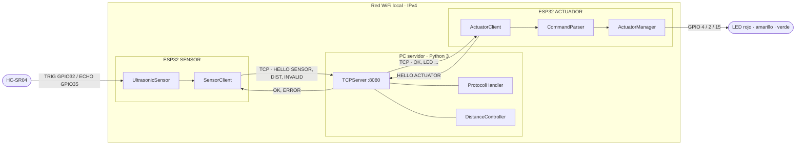

| Nodo | Hardware / software | Responsabilidad |
| --- | --- | --- |
| ESP32 SENSOR | ESP32 DOIT DevKit V1 + HC-SR04, firmware C++ (Arduino) | Medir, validar y enviar distancias. No clasifica ni controla LEDs. |
| Servidor | PC con Python 3, escucha en `0.0.0.0:8080` | Identificar clientes, validar mensajes, clasificar distancias, controlar la vigencia y enviar comandos. |
| ESP32 ACTUADOR | ESP32 DOIT DevKit V1 + 3 LEDs, firmware C++ (Arduino) | Ejecutar comandos, temporizar el parpadeo y apagar por seguridad. No conoce distancias. |

### 2.2 Diagrama de circuito de cada objeto inteligente

**Objeto inteligente 1 — Sensor**

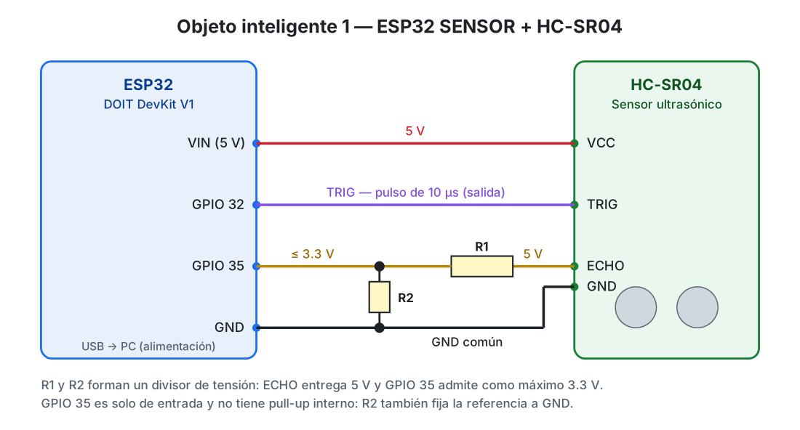

| HC-SR04 | ESP32 | Observación |
| --- | --- | --- |
| VCC | VIN (5 V) | El HC-SR04 requiere 5 V. |
| TRIG | GPIO 32 | Salida; pulso de 10 µs. |
| ECHO | GPIO 35 a través del divisor R1/R2 | ECHO entrega 5 V; el divisor lo reduce a ≤ 3.3 V. GPIO 35 es solo entrada. |
| GND | GND | Masa común con el divisor. |

**Objeto inteligente 2 — Actuador**

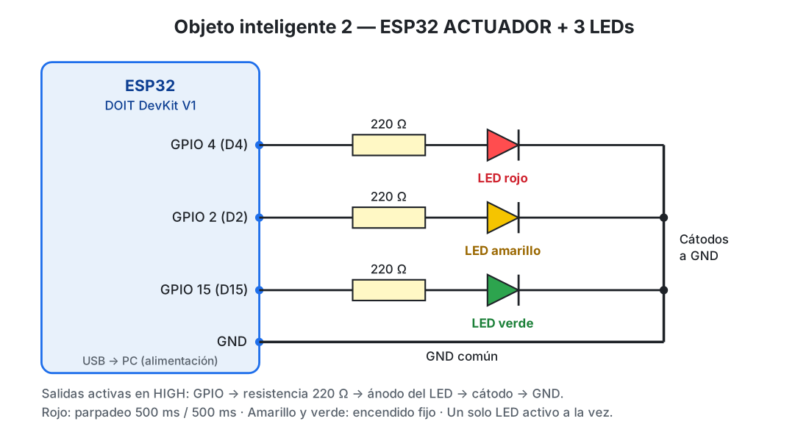

| LED | ESP32 | Resistencia | Comportamiento |
| --- | --- | --- | --- |
| Rojo | GPIO 4 (D4) | 220 Ω a GND | Parpadeo 500 ms / 500 ms |
| Amarillo | GPIO 2 (D2) | 220 Ω a GND | Encendido fijo |
| Verde | GPIO 15 (D15) | 220 Ω a GND | Encendido fijo |

### 2.3 Diagrama de clases (estructural)

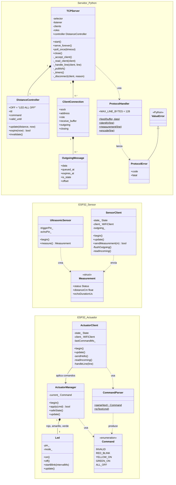

Decisiones de diseño:

- **Separación de responsabilidades.** `ProtocolHandler` (sintaxis) y `DistanceController` (reglas de negocio) no dependen de sockets, por eso se prueban de forma aislada. `TCPServer` coordina la red, las sesiones de los clientes y los temporizadores.
- **Máquinas de estado en los ESP32.** `SensorClient` y `ActuatorClient` avanzan un paso en cada `loop()` usando solo esperas cortas y acotadas, para no detener la medición ni el parpadeo (ver [Anexo B](#anexo-b--máquinas-de-estado-de-los-clientes-esp32)).
- **Tabla de comandos única** en `CommandParser`: todos los textos del protocolo se reconocen desde una sola tabla. Para un comando nuevo se agrega una fila, su valor en el enum `Command` y su comportamiento en `ActuatorManager::apply()`.

### 2.4 Diagrama de secuencia (comportamiento)

Muestra el intercambio de mensajes entre los dos clientes y el servidor, incluyendo la identificación, la operación normal, la vigencia de la lectura y los casos de falla.

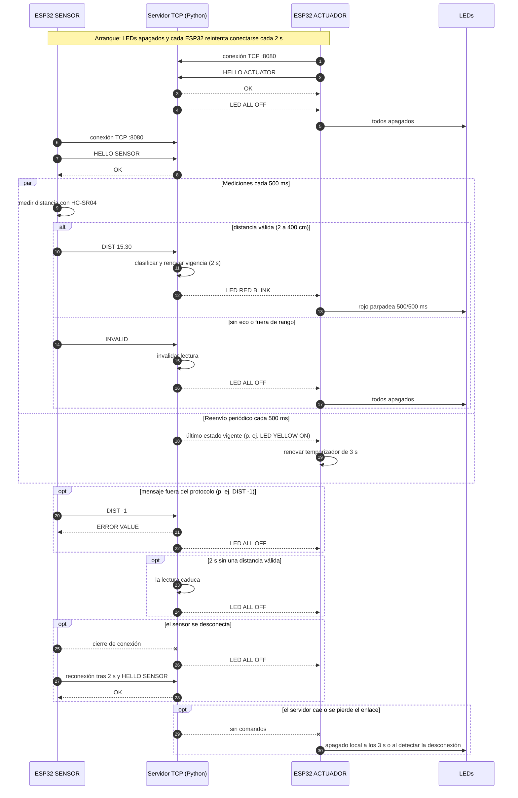

### 2.5 Especificación del protocolo de aplicación

Para que los ESP32 y el servidor se entiendan, definimos nuestro propio protocolo sobre TCP. Elegimos mensajes de texto plano porque son fáciles de leer y de depurar desde el monitor serie. En esta sección explicamos sus reglas principales; el detalle completo está en [`server/README.md`](../server/README.md).

#### Transporte y formato

| Aspecto | Definición |
| --- | --- |
| Transporte | TCP/IPv4, puerto **8080**, una conexión persistente por ESP32. |
| Codificación | ASCII, sensible a mayúsculas. |
| Delimitador | Un byte LF (`0x0A`) al final de cada mensaje. No se usa CRLF. |
| Longitud máxima | 128 bytes de contenido por línea, sin contar LF. |
| Campos | Separados por un único espacio; sin espacios iniciales/finales ni líneas vacías. |
| Framing | Cada conexión tiene su propio buffer: un `recv()` puede traer medio mensaje o varios mensajes. |

#### Mensajes

| Dirección | Mensaje | Significado |
| --- | --- | --- |
| Cliente → servidor | `HELLO SENSOR` | Identificación del sensor (primer mensaje obligatorio). |
| Cliente → servidor | `HELLO ACTUATOR` | Identificación del actuador (primer mensaje obligatorio). |
| Servidor → cliente | `OK` | Identificación aceptada. Solo se usa para la identificación. |
| Sensor → servidor | `DIST <n>` | Distancia válida en cm. `<n>` cumple `[0-9]+(\.[0-9]+)?` y está entre 2 y 400. Ej.: `DIST 25.50`. |
| Sensor → servidor | `INVALID` | La medición falló (sin eco o fuera de rango). |
| Servidor → actuador | `LED RED BLINK` | Distancia < 20 cm: solo rojo, parpadeando. |
| Servidor → actuador | `LED YELLOW ON` | 20 ≤ distancia ≤ 40 cm: solo amarillo. |
| Servidor → actuador | `LED GREEN ON` | Distancia > 40 cm: solo verde. |
| Servidor → actuador | `LED ALL OFF` | Lectura inválida, vencida o sensor desconectado: todos apagados. |
| Servidor → cliente | `ERROR <código>` | Mensaje rechazado (ver tabla de errores). |

Gramática resumida (estilo ABNF):

```text
mensaje      = contenido LF                 ; contenido de 1 a 128 bytes ASCII
hello        = "HELLO " ( "SENSOR" / "ACTUATOR" )
medicion     = "DIST " numero / "INVALID"
numero       = 1*DIGIT [ "." 1*DIGIT ]      ; 2 <= numero <= 400
comando      = "LED " ( "RED BLINK" / "YELLOW ON" / "GREEN ON" / "ALL OFF" )
respuesta    = "OK" / "ERROR " codigo
codigo       = "IDENTIFICATION" / "ROLE" / "DUPLICATE" / "FORMAT" / "VALUE"
             / "TOO_LONG" / "ENCODING" / "TIMEOUT"
```

#### Secuencia obligatoria

1. El cliente abre la conexión TCP y envía `HELLO <ROL>` dentro de **5 s**.
2. El servidor responde `OK`. Si el cliente es el actuador, envía además `LED ALL OFF` y espera una lectura nueva.
3. El sensor envía `DIST` o `INVALID` cada **500 ms**. No hay confirmación por medición.
4. El servidor responde a cada medición con un comando al actuador y lo **reenvía cada 500 ms** mientras el actuador esté conectado.
5. Ante una desconexión, el cliente reintenta cada **2 s** y vuelve al paso 1. No se recupera ningún estado anterior.

#### Errores

| Respuesta | Causa | Acción del servidor sobre la conexión |
| --- | --- | --- |
| `ERROR IDENTIFICATION` | El primer mensaje no es `HELLO`. | Cerrar |
| `ERROR ROLE` | Rol desconocido (`HELLO OTRO`). | Cerrar |
| `ERROR DUPLICATE` | El rol ya está conectado. | Cerrar la conexión nueva |
| `ERROR FORMAT` | Sintaxis incorrecta o mensaje no permitido para ese rol. | Mantener |
| `ERROR VALUE` | Número no admitido o fuera de 2–400 cm. | Mantener |
| `ERROR TOO_LONG` | Más de 128 bytes antes de LF. | Cerrar |
| `ERROR ENCODING` | Bytes fuera de ASCII. | Cerrar |
| `ERROR TIMEOUT` | No se identificó en 5 s. | Cerrar |

Un error del sensor invalida la lectura vigente y apaga los LEDs.

#### Comportamiento de los clientes

| Situación | ESP32 sensor | ESP32 actuador |
| --- | --- | --- |
| Antes de recibir `OK` | No envía mediciones. | No enciende ningún LED. |
| Recibe una respuesta distinta de `OK` al identificarse | Cierra la conexión y reintenta en 2 s. | Cierra la conexión y reintenta en 2 s. |
| Recibe `ERROR` durante la sesión | Cierra la conexión y reintenta en 2 s. | Lo trata como un comando inválido: apaga los LEDs. |
| Recibe un comando desconocido o mal formado | — | Apaga todos los LEDs y no renueva su temporizador de 3 s. |
| Recibe una línea de más de 128 bytes o con caracteres no válidos | Cierra la conexión y reintenta. | Apaga los LEDs, cierra la conexión y reintenta. |
| Se reconecta | Repite `HELLO` y no envía lecturas antiguas. | Repite `HELLO` y empieza con los LEDs apagados. |

#### Temporización

| Parámetro | Valor | Responsable |
| --- | --- | --- |
| Intervalo de medición y envío | 500 ms | Sensor |
| Plazo de identificación | 5 s | Servidor y clientes |
| Vigencia de la última distancia válida | 2 s | Servidor |
| Reenvío periódico del estado | 500 ms | Servidor |
| Apagado local sin comandos válidos | 3 s | Actuador |
| Reintento de conexión WiFi/TCP | 2 s | Ambos ESP32 |

---

## 3. Desarrollo e implementación

### 3.1 Tecnologías

| Componente | Tecnología |
| --- | --- |
| Servidor | Python 3.7+ (solo biblioteca estándar: `socket`, `selectors`, `decimal`, `argparse`, `logging`, `unittest`) |
| Firmware | C++ con framework Arduino para ESP32 (compilado con Espressif32 7.1.0 y Arduino ESP32 2.0.17) |
| Compilación y carga | PlatformIO con dos entornos: `sensor` y `actuator` ([`platformio.ini`](https://github.com/ciriarte-dev/IoT-practice-2-smart-objects-integration-over-TCP-IP-with-ESP32/blob/8e0742b/platformio.ini)) |
| Control de versiones | Git y GitHub con ramas por componente y pull requests |

### 3.2 Estructura del repositorio

```text
.
├── README.md                 # Presentación del proyecto y enlace al informe
├── platformio.ini            # Entornos "sensor" y "actuator" (un firmware por carpeta)
├── docs/
│   ├── informe.md            # Este informe
│   └── images/               # Diagramas de circuito y evidencias
├── server/                   # Servidor TCP en Python
│   ├── main.py               # Punto de entrada y argumentos de línea de comandos
│   ├── tcp_server.py         # TCPServer, ClientConnection, OutgoingMessage
│   ├── protocol.py           # ProtocolHandler, ProtocolError
│   ├── controller.py         # DistanceController
│   └── tests/                # Pruebas del servidor
└── src/
    ├── sensor/               # Firmware del ESP32 sensor
    │   ├── main.cpp
    │   ├── UltrasonicSensor.h/.cpp
    │   ├── SensorClient.h/.cpp
    │   ├── SensorConfig.h
    │   ├── secrets.example.h
    │   └── tests/            # Pruebas del sensor
    └── actuator/             # Firmware del ESP32 actuador
        ├── main.cpp
        ├── Led.h/.cpp
        ├── ActuatorManager.h/.cpp
        ├── CommandParser.h/.cpp
        ├── ActuatorClient.h/.cpp
        ├── ActuatorConfig.h
        ├── secrets.example.h
        └── tests/            # Pruebas del actuador
```

### 3.3 Servidor TCP (Python)

| Módulo | Clases | Responsabilidad |
| --- | --- | --- |
| [`main.py`](https://github.com/ciriarte-dev/IoT-practice-2-smart-objects-integration-over-TCP-IP-with-ESP32/blob/8e0742b/server/main.py) | — | Lee los argumentos (`--host`, `--port`, plazos), crea el servidor y maneja Ctrl+C. |
| [`tcp_server.py`](https://github.com/ciriarte-dev/IoT-practice-2-smart-objects-integration-over-TCP-IP-with-ESP32/blob/8e0742b/server/tcp_server.py) | `TCPServer`, `ClientConnection`, `OutgoingMessage` | Bucle de eventos, sesiones por cliente, roles, colas de salida y temporizadores. |
| [`protocol.py`](https://github.com/ciriarte-dev/IoT-practice-2-smart-objects-integration-over-TCP-IP-with-ESP32/blob/8e0742b/server/protocol.py) | `ProtocolHandler`, `ProtocolError` | Separación de mensajes y validación de cada uno. |
| [`controller.py`](https://github.com/ciriarte-dev/IoT-practice-2-smart-objects-integration-over-TCP-IP-with-ESP32/blob/8e0742b/server/controller.py) | `DistanceController` | Clasificación de la distancia y vigencia de la lectura. |

**Fragmentos clave**

**1. Atender a dos clientes al mismo tiempo** — [`TCPServer.poll_once()`](https://github.com/ciriarte-dev/IoT-practice-2-smart-objects-integration-over-TCP-IP-with-ESP32/blob/8e0742b/server/tcp_server.py#L104-L122)

El servidor debe atender al sensor y al actuador a la vez, sin que uno haga esperar al otro. En lugar de crear un hilo por cliente, usa el módulo `selectors` de Python, que indica qué conexión tiene datos listos para atender solo esa. Antes de cada espera, [`_wait_time()`](https://github.com/ciriarte-dev/IoT-practice-2-smart-objects-integration-over-TCP-IP-with-ESP32/blob/8e0742b/server/tcp_server.py#L124-L136) calcula cuánto falta para el próximo evento programado (por ejemplo, una lectura que vence o un reenvío), para no esperar de más.

**2. Mensajes que llegan partidos o juntos** — [`ProtocolHandler.feed()`](https://github.com/ciriarte-dev/IoT-practice-2-smart-objects-integration-over-TCP-IP-with-ESP32/blob/8e0742b/server/protocol.py#L17-L34)

TCP entrega bytes, no mensajes completos: una lectura puede traer `DIST 2` y la siguiente `5.50\n`. Por eso cada conexión tiene su propio buffer, donde se acumulan los bytes hasta encontrar el salto de línea, y recién entonces se procesa el mensaje. Si llega un byte que no es ASCII o la línea pasa de 128 bytes, se responde con un error y se cierra esa conexión.

**3. Validar cada medición** — [`ProtocolHandler.measurement()`](https://github.com/ciriarte-dev/IoT-practice-2-smart-objects-integration-over-TCP-IP-with-ESP32/blob/8e0742b/server/protocol.py#L44-L57)

Antes de usar una distancia, el servidor revisa que el mensaje tenga la forma correcta (error `FORMAT`) y que el número sea válido y esté entre 2 y 400 cm (error `VALUE`). El valor se convierte con `decimal.Decimal` en lugar de `float`, porque `float` redondea los números con muchos decimales: `19.99999999999999999999` se convertiría en `20.0` y se clasificaría como amarillo en lugar de rojo. Con `Decimal`, el valor se compara exactamente como llegó.

**4. Decidir qué LED encender** — [`DistanceController.update()`](https://github.com/ciriarte-dev/IoT-practice-2-smart-objects-integration-over-TCP-IP-with-ESP32/blob/8e0742b/server/controller.py#L16-L26)

Aquí está la regla de negocio: menos de 20 cm es rojo, de 20 a 40 cm es amarillo y más de 40 cm es verde. Cada distancia válida queda vigente 2 segundos. Si no llega otra a tiempo, [`expire()`](https://github.com/ciriarte-dev/IoT-practice-2-smart-objects-integration-over-TCP-IP-with-ESP32/blob/8e0742b/server/controller.py#L28-L32) la invalida y el estado pasa a apagado. Esta clase no sabe nada de la red, por eso se puede probar sola.

**5. Identificar a cada cliente** — [`TCPServer._handle_line()`](https://github.com/ciriarte-dev/IoT-practice-2-smart-objects-integration-over-TCP-IP-with-ESP32/blob/8e0742b/server/tcp_server.py#L179-L199)

El primer mensaje de cada conexión debe ser `HELLO SENSOR` o `HELLO ACTUATOR`; si el rol ya está ocupado, se rechaza la conexión nueva. Cuando el actuador se conecta, el servidor descarta la última lectura y espera una nueva, para no encender un LED con datos de antes de la conexión.

**6. No enviar colores desactualizados** — [`TCPServer._publish()`](https://github.com/ciriarte-dev/IoT-practice-2-smart-objects-integration-over-TCP-IP-with-ESP32/blob/8e0742b/server/tcp_server.py#L266-L289)

Prepara el comando para el actuador. Si la orden nueva es apagar, primero quita de la cola los colores que todavía no se habían enviado, para que ninguno llegue después del `LED ALL OFF`.

**7. Clientes lentos** — [`_queue()`](https://github.com/ciriarte-dev/IoT-practice-2-smart-objects-integration-over-TCP-IP-with-ESP32/blob/8e0742b/server/tcp_server.py#L212-L221) y [`_write_client()`](https://github.com/ciriarte-dev/IoT-practice-2-smart-objects-integration-over-TCP-IP-with-ESP32/blob/8e0742b/server/tcp_server.py#L237-L264)

Si la red está lenta, un mensaje puede enviarse a medias. El servidor recuerda cuántos bytes ya envió y continúa desde ahí. Para que un cliente que no recibe datos no acumule memoria sin límite, si su cola pasa de 1024 bytes o un mensaje lleva más de 1 segundo sin enviarse, se cierra solo esa conexión.

**8. Plazos y reenvíos** — [`TCPServer._timers()`](https://github.com/ciriarte-dev/IoT-practice-2-smart-objects-integration-over-TCP-IP-with-ESP32/blob/8e0742b/server/tcp_server.py#L291-L302)

Revisa en cada vuelta del bucle los cuatro plazos del sistema: la vigencia de la lectura (2 s), el reenvío al actuador (500 ms), el tiempo máximo de envío (1 s) y el plazo para identificarse (5 s).

**9. Apagado al cerrar el servidor** — [`TCPServer.close()`](https://github.com/ciriarte-dev/IoT-practice-2-smart-objects-integration-over-TCP-IP-with-ESP32/blob/8e0742b/server/tcp_server.py#L329-L350)

Al detener el servidor con Ctrl+C, intenta enviar `LED ALL OFF` al actuador antes de cerrar todas las conexiones. No puede garantizar que llegue; por eso el actuador también se apaga solo a los 3 segundos sin comandos.

### 3.4 Firmware del ESP32 sensor (C++)

| Archivo | Clase | Responsabilidad |
| --- | --- | --- |
| [`UltrasonicSensor.h`](https://github.com/ciriarte-dev/IoT-practice-2-smart-objects-integration-over-TCP-IP-with-ESP32/blob/8e0742b/src/sensor/UltrasonicSensor.h) / [`.cpp`](https://github.com/ciriarte-dev/IoT-practice-2-smart-objects-integration-over-TCP-IP-with-ESP32/blob/8e0742b/src/sensor/UltrasonicSensor.cpp) | `UltrasonicSensor` | Disparar el HC-SR04, medir el eco y validar el rango. |
| [`SensorClient.h`](https://github.com/ciriarte-dev/IoT-practice-2-smart-objects-integration-over-TCP-IP-with-ESP32/blob/8e0742b/src/sensor/SensorClient.h) / [`.cpp`](https://github.com/ciriarte-dev/IoT-practice-2-smart-objects-integration-over-TCP-IP-with-ESP32/blob/8e0742b/src/sensor/SensorClient.cpp) | `SensorClient` | WiFi, TCP, identificación, envío de mediciones y reconexión. |
| [`SensorConfig.h`](https://github.com/ciriarte-dev/IoT-practice-2-smart-objects-integration-over-TCP-IP-with-ESP32/blob/8e0742b/src/sensor/SensorConfig.h) | — | Pines (TRIG 32, ECHO 35), intervalos y límites. |
| [`main.cpp`](https://github.com/ciriarte-dev/IoT-practice-2-smart-objects-integration-over-TCP-IP-with-ESP32/blob/8e0742b/src/sensor/main.cpp) | — | Programa una medición cada 500 ms y la entrega al cliente. |

**Fragmentos clave**

**1. Medir la distancia** — [`UltrasonicSensor::measure()`](https://github.com/ciriarte-dev/IoT-practice-2-smart-objects-integration-over-TCP-IP-with-ESP32/blob/8e0742b/src/sensor/UltrasonicSensor.cpp#L14-L34)

El HC-SR04 emite un pulso de ultrasonido y mide cuánto tarda en volver el eco. El código activa el pin TRIG durante 10 µs, mide la duración del eco con `pulseIn()` y la convierte a centímetros dividiendo entre 58, como indica la hoja de datos del sensor. Si no vuelve ningún eco en 30 ms, o la distancia queda fuera de 2 a 400 cm, no devuelve un número inventado, sino un estado de error (`EchoTimeout` u `OutOfRange`).

**2. Medir cada 500 ms sin detener el programa** — [`loop()`](https://github.com/ciriarte-dev/IoT-practice-2-smart-objects-integration-over-TCP-IP-with-ESP32/blob/8e0742b/src/sensor/main.cpp#L23-L50)

Un `delay(500)` dejaría al ESP32 sin atender la red durante medio segundo. En su lugar, el `loop()` compara el reloj interno (`millis()`) con la hora de la última medición y solo mide cuando ya pasaron 500 ms; el resto del tiempo sigue atendiendo la conexión. La resta usa números sin signo, para que el cálculo siga funcionando cuando `millis()` se reinicia a cero (después de unos 49 días encendido). El sensor sigue midiendo aunque no haya conexión; esas lecturas solo se muestran por el monitor serie.

**3. Conectarse paso a paso** — [`SensorClient::update()`](https://github.com/ciriarte-dev/IoT-practice-2-smart-objects-integration-over-TCP-IP-with-ESP32/blob/8e0742b/src/sensor/SensorClient.cpp#L42-L89)

Conectarse al WiFi y al servidor toma tiempo, y el ESP32 no puede quedarse esperando. Por eso la conexión es una máquina de estados que avanza un paso en cada `loop()`: esperar WiFi → abrir la conexión TCP → enviar `HELLO SENSOR` → esperar `OK` → listo para enviar. Si algo falla (no hay WiFi, el servidor no responde o no llega el `OK` en 5 segundos), vuelve a intentarlo cada 2 segundos.

**4. Enviar sin quedarse esperando** — [`SensorClient::flushOutgoing()`](https://github.com/ciriarte-dev/IoT-practice-2-smart-objects-integration-over-TCP-IP-with-ESP32/blob/8e0742b/src/sensor/SensorClient.cpp#L103-L130)

La función de envío normal de Arduino (`WiFiClient::write()`) puede bloquear el programa varios segundos si la red está lenta. Para evitarlo, el código envía con `send(..., MSG_DONTWAIT)`, que devuelve el control de inmediato. Si solo se envía una parte del mensaje, recuerda cuánto falta y lo completa en la siguiente vuelta. Si en 200 ms no logra enviarlo, cierra la conexión y la vuelve a intentar a los 2 segundos.

**5. Formar el mensaje** — [`SensorClient::sendMeasurement()`](https://github.com/ciriarte-dev/IoT-practice-2-smart-objects-integration-over-TCP-IP-with-ESP32/blob/8e0742b/src/sensor/SensorClient.cpp#L162-L183)

Antes de enviar, vuelve a comprobar que la medición sea válida y esté entre 2 y 400 cm. Si lo es, envía `DIST` con dos decimales (por ejemplo, `DIST 25.50`); si no, envía `INVALID`. Solo envía mediciones nuevas, tomadas después de recibir `OK`: nunca reenvía lecturas de antes de una reconexión.

**6. Leer las respuestas del servidor** — [`readIncoming()`](https://github.com/ciriarte-dev/IoT-practice-2-smart-objects-integration-over-TCP-IP-with-ESP32/blob/8e0742b/src/sensor/SensorClient.cpp#L132-L148) y [`handleLine()`](https://github.com/ciriarte-dev/IoT-practice-2-smart-objects-integration-over-TCP-IP-with-ESP32/blob/8e0742b/src/sensor/SensorClient.cpp#L150-L160)

El sensor arma cada respuesta byte a byte hasta encontrar el salto de línea, por si el `OK` llega partido. La única respuesta que acepta es `OK`, al identificarse. Cualquier otra cosa (un `ERROR`, un `OK` repetido o caracteres inválidos) la considera un problema: cierra la conexión y vuelve a empezar.

### 3.5 Firmware del ESP32 actuador (C++)

| Archivo | Clase | Responsabilidad |
| --- | --- | --- |
| [`Led.h`](https://github.com/ciriarte-dev/IoT-practice-2-smart-objects-integration-over-TCP-IP-with-ESP32/blob/8e0742b/src/actuator/Led.h) / [`.cpp`](https://github.com/ciriarte-dev/IoT-practice-2-smart-objects-integration-over-TCP-IP-with-ESP32/blob/8e0742b/src/actuator/Led.cpp) | `Led` | Encender, apagar y hacer parpadear un LED sin bloquear. |
| [`ActuatorManager.h`](https://github.com/ciriarte-dev/IoT-practice-2-smart-objects-integration-over-TCP-IP-with-ESP32/blob/8e0742b/src/actuator/ActuatorManager.h) / [`.cpp`](https://github.com/ciriarte-dev/IoT-practice-2-smart-objects-integration-over-TCP-IP-with-ESP32/blob/8e0742b/src/actuator/ActuatorManager.cpp) | `ActuatorManager` | Garantizar un solo LED activo y el estado seguro. |
| [`CommandParser.h`](https://github.com/ciriarte-dev/IoT-practice-2-smart-objects-integration-over-TCP-IP-with-ESP32/blob/8e0742b/src/actuator/CommandParser.h) / [`.cpp`](https://github.com/ciriarte-dev/IoT-practice-2-smart-objects-integration-over-TCP-IP-with-ESP32/blob/8e0742b/src/actuator/CommandParser.cpp) | `CommandParser`, `Command` | Traducir el texto recibido a un comando. |
| [`ActuatorClient.h`](https://github.com/ciriarte-dev/IoT-practice-2-smart-objects-integration-over-TCP-IP-with-ESP32/blob/8e0742b/src/actuator/ActuatorClient.h) / [`.cpp`](https://github.com/ciriarte-dev/IoT-practice-2-smart-objects-integration-over-TCP-IP-with-ESP32/blob/8e0742b/src/actuator/ActuatorClient.cpp) | `ActuatorClient` | WiFi, TCP, identificación, recepción y temporizador de seguridad. |
| [`ActuatorConfig.h`](https://github.com/ciriarte-dev/IoT-practice-2-smart-objects-integration-over-TCP-IP-with-ESP32/blob/8e0742b/src/actuator/ActuatorConfig.h) | — | Pines (4, 2, 15), tiempos y límites. |
| [`main.cpp`](https://github.com/ciriarte-dev/IoT-practice-2-smart-objects-integration-over-TCP-IP-with-ESP32/blob/8e0742b/src/actuator/main.cpp) | — | Arranca con los LEDs apagados y actualiza la red y los LEDs en cada `loop()`. |

**Fragmentos clave**

**1. Arrancar siempre apagado** — [`setup()` y `loop()`](https://github.com/ciriarte-dev/IoT-practice-2-smart-objects-integration-over-TCP-IP-with-ESP32/blob/8e0742b/src/actuator/main.cpp#L36-L53)

Al encender o reiniciar el ESP32, un pin puede quedar en un estado indefinido y encender un LED por error. Por eso `setup()` apaga los tres LEDs antes de intentar conectarse a la red. Después, en cada vuelta, el `loop()` atiende primero la conexión y luego actualiza los LEDs.

**2. Reconocer los comandos** — [`CommandParser::parse()`](https://github.com/ciriarte-dev/IoT-practice-2-smart-objects-integration-over-TCP-IP-with-ESP32/blob/8e0742b/src/actuator/CommandParser.cpp#L12-L31)

Los cuatro comandos válidos están en una sola tabla (`kCommands`). El texto recibido se compara exactamente con cada fila: no se aceptan espacios de más ni cambios de mayúsculas. Si no coincide con ninguno, el resultado es `INVALID`.

**3. Un solo LED encendido a la vez** — [`ActuatorManager::apply()`](https://github.com/ciriarte-dev/IoT-practice-2-smart-objects-integration-over-TCP-IP-with-ESP32/blob/8e0742b/src/actuator/ActuatorManager.cpp#L18-L47)

Para que nunca queden dos LEDs encendidos, cada comando primero apaga los tres y luego enciende solo el que corresponde. El servidor reenvía el mismo comando cada 500 ms; si el comando recibido es el que ya está activo, no se hace nada, para que el parpadeo del rojo no se reinicie con cada reenvío. Un comando inválido lleva al estado seguro: todo apagado.

**4. Parpadear sin detener el programa** — [`Led::startBlink()` y `Led::update()`](https://github.com/ciriarte-dev/IoT-practice-2-smart-objects-integration-over-TCP-IP-with-ESP32/blob/8e0742b/src/actuator/Led.cpp#L20-L38)

Un `delay(500)` para el parpadeo dejaría al ESP32 sin atender la red. En su lugar, cada LED guarda el momento de su último cambio, y en cada vuelta del `loop()` se compara con `millis()`: cuando pasaron 500 ms, el LED cambia de estado.

**5. Apagarse solo si el servidor deja de hablar** — [`ActuatorClient::update()`](https://github.com/ciriarte-dev/IoT-practice-2-smart-objects-integration-over-TCP-IP-with-ESP32/blob/8e0742b/src/actuator/ActuatorClient.cpp#L69-L74)

Si el servidor se cae o la red falla sin cerrar la conexión, el actuador podría quedarse mostrando un color viejo. Para evitarlo, tiene un temporizador de seguridad: si pasan 3 segundos sin recibir un comando válido, apaga los LEDs y cierra la conexión. Esta revisión se hace antes de leer los datos pendientes, para no aplicar comandos atrasados.

**6. Recibir y aplicar comandos** — [`readIncoming()` y `handleLine()`](https://github.com/ciriarte-dev/IoT-practice-2-smart-objects-integration-over-TCP-IP-with-ESP32/blob/8e0742b/src/actuator/ActuatorClient.cpp#L128-L167)

Los comandos se arman byte a byte hasta el salto de línea, con un máximo de 128 bytes. Hasta recibir `OK` del servidor no se acepta ningún comando. Después, solo los comandos válidos renuevan el temporizador de 3 segundos; uno inválido apaga los LEDs pero no lo renueva.

**7. Perder la conexión** — [`ActuatorClient::onConnectionLost()`](https://github.com/ciriarte-dev/IoT-practice-2-smart-objects-integration-over-TCP-IP-with-ESP32/blob/8e0742b/src/actuator/ActuatorClient.cpp#L92-L99)

Cualquier falla de red (WiFi perdido, servidor desconectado, respuesta inesperada) termina aquí: apaga los LEDs, cierra la conexión, descarta lo que se había recibido a medias y programa un nuevo intento a los 2 segundos.

## 4. Pruebas y validaciones
 
### 4.1 Estrategia
 
Validamos el sistema en dos niveles antes de la demostración:
 
| Nivel | Qué valida | Cómo |
| --- | --- | --- |
| Integración con clientes simulados | El servidor real comunicándose por TCP con dos clientes que envían los mismos mensajes que los ESP32. | Ejecución local del servidor y registro de su consola. |
| Mediciones con el HC-SR04 | La precisión del sensor ultrasónico con distancias reales. | Mediciones manuales con regla, comparadas con la lectura del sensor. |
 
La validación del sistema completo, con los dos ESP32 y los LEDs, se realiza en la demostración (sección 4.4).
 
### 4.2 Integración con clientes simulados
 
Ejecutamos el servidor real y conectamos dos clientes que envían los mismos mensajes que los ESP32: primero se identifica el actuador, luego el sensor envía tres distancias y una lectura inválida, después el sensor se desconecta y, al final, el servidor se detiene con Ctrl+C.
 
| Mensaje del sensor | Comando esperado | Comando registrado por el servidor | Cumple |
| --- | --- | --- | --- |
| `DIST 15.30` | `LED RED BLINK` | `LED RED BLINK` | Sí |
| `DIST 32.10` | `LED YELLOW ON` | `LED YELLOW ON` | Sí |
| `DIST 58.75` | `LED GREEN ON` | `LED GREEN ON` | Sí |
| `INVALID` | `LED ALL OFF` | `LED ALL OFF` | Sí |
 
Registro de la consola del servidor:
 
```text
2026-10-13 08:59:25,864 INFO Servidor escuchando en 127.0.0.1:8080
2026-10-13 08:59:26,806 INFO Cliente conectado: 127.0.0.1:46408
2026-10-13 08:59:26,806 INFO Identificación ACTUATOR: 127.0.0.1:46408
2026-10-13 08:59:27,007 INFO Cliente conectado: 127.0.0.1:46412
2026-10-13 08:59:27,007 INFO Identificación SENSOR: 127.0.0.1:46412
2026-10-13 08:59:27,207 INFO Medición SENSOR: 15.30
2026-10-13 08:59:27,207 INFO Estado LEDs: LED RED BLINK
2026-10-13 08:59:27,508 INFO Medición SENSOR: 32.10
2026-10-13 08:59:27,508 INFO Estado LEDs: LED YELLOW ON
2026-10-13 08:59:27,808 INFO Medición SENSOR: 58.75
2026-10-13 08:59:27,808 INFO Estado LEDs: LED GREEN ON
2026-10-13 08:59:28,108 INFO Medición SENSOR: INVALID
2026-10-13 08:59:28,108 INFO Estado LEDs: LED ALL OFF
2026-10-13 08:59:28,408 INFO Cliente desconectado: 127.0.0.1:46412 (cierre remoto)
2026-10-13 08:59:29,110 INFO Cliente desconectado: 127.0.0.1:46408 (cierre del servidor)
2026-10-13 08:59:29,110 INFO Servidor cerrado
2026-10-13 08:59:29,110 INFO Interrupción Ctrl+C recibida; salida normal
```
 
Las direcciones son `127.0.0.1` porque los clientes corrían en la misma computadora que el servidor. Con los ESP32 aparecen las direcciones IP de la red WiFi.
 
### 4.3 Mediciones con el HC-SR04
 
Estas mediciones se hicieron durante el desarrollo, con una versión anterior del firmware del sensor. Por eso solo se reportan las distancias medidas, que dependen del sensor y no de la lógica de los LEDs. Cada distancia se midió con una regla desde el frente del sensor hasta una superficie plana.
 
**Precisión a distintas distancias**
 
| Distancia real | Distancia medida | Error absoluto | Error relativo |
| --- | --- | --- | --- |
| 5 cm | 4.97 cm | 0.03 cm | 0.60 % |
| 10 cm | 10.20 cm | 0.20 cm | 2.00 % |
| 20 cm | 20.10 cm | 0.10 cm | 0.50 % |
| 30 cm | 30.07 cm | 0.07 cm | 0.23 % |
| 40 cm | 40.03 cm | 0.03 cm | 0.08 % |
| 50 cm | 50.30 cm | 0.30 cm | 0.60 % |
| 60 cm | 60.15 cm | 0.15 cm | 0.25 % |
| 100 cm | 100.14 cm | 0.14 cm | 0.14 % |
 
**Repetibilidad en las fronteras**
 
| Distancia real | Intento 1 | Intento 2 | Intento 3 | Variación |
| --- | --- | --- | --- | --- |
| 20 cm | 19.97 cm | 20.00 cm | 20.10 cm | 0.13 cm |
| 40 cm | 39.95 cm | 40.00 cm | 40.05 cm | 0.10 cm |
 
**Lecturas inválidas**
 
| Condición | Lectura del sensor |
| --- | --- |
| Sin objeto frente al sensor | Inválida |
| Sensor apuntando a un espacio abierto | Inválida |
| Objeto alejándose del sensor | Midió hasta 330.97 cm y después la lectura pasó a ser inválida |
 
### 4.4 Validación en la demostración
 
El funcionamiento del sistema completo se verifica en la defensa, con los dos ESP32, el servidor y los LEDs:
 
| Prueba | Resultado esperado |
| --- | --- |
| Encender el servidor y los dos ESP32 | Ambos se identifican y aparecen en la consola del servidor. |
| Objeto a menos de 20 cm | Solo el LED rojo, parpadeando cada 500 ms. |
| Objeto entre 20 y 40 cm | Solo el LED amarillo encendido. |
| Objeto a más de 40 cm | Solo el LED verde encendido. |
| Sin objeto frente al sensor | Todos los LEDs apagados. |
| Desconectar la alimentación del sensor | Los LEDs se apagan en 2 s como máximo. |
| Detener el servidor | El actuador apaga sus LEDs. |
| Volver a iniciar el servidor | Los dos ESP32 se reconectan solos. |
 
---
 
## 5. Resultados
 
### 5.1 Integración con clientes simulados
 
| Aspecto | Resultado |
| --- | --- |
| Identificación de los dos clientes | Correcta, con `OK` para cada uno. |
| Clasificación de las distancias | 4 de 4 comandos correctos (rojo, amarillo, verde y apagado). |
| Desconexión del sensor | Detectada y registrada como cierre remoto. |
| Cierre con Ctrl+C | Ordenado: cerró las conexiones y terminó con código de salida 0. |
 
### 5.2 Mediciones con el HC-SR04
 
| Indicador | Valor |
| --- | --- |
| Error absoluto promedio | 0.13 cm |
| Error absoluto máximo | 0.30 cm (a 50 cm) |
| Error relativo máximo | 2.00 % (a 10 cm) |
| Variación entre intentos en 20 cm | 0.13 cm (de 19.97 a 20.10 cm) |
| Variación entre intentos en 40 cm | 0.10 cm (de 39.95 a 40.05 cm) |
| Mayor distancia medida | 330.97 cm |
 
El sensor midió con un error menor a un tercio de centímetro en todo el rango probado. La variación de unos 0.1 cm en las fronteras significa que un objeto ubicado justo en 20 o 40 cm puede quedar a uno u otro lado del umbral entre una lectura y la siguiente. Cuando no hay un objeto frente al sensor, o está demasiado lejos, la lectura es inválida, como se espera.
 
### 5.3 Compilación del firmware
 
| Firmware | Resultado | RAM usada | Flash usada |
| --- | --- | --- | --- |
| Sensor | Compilación exitosa | 45 024 bytes (13.7 %) | 746 465 bytes (57.0 %) |
| Actuador | Compilación exitosa | 44 952 bytes (13.7 %) | 746 581 bytes (57.0 %) |
 
Ambos firmware se compilaron con Espressif32 7.1.0 y Arduino ESP32 2.0.17. El uso de memoria deja margen para agregar funciones.
 
### 5.4 Funcionamiento del sistema completo
 
El funcionamiento con los dos ESP32, el servidor y los LEDs se verifica en la demostración, con las pruebas de la sección 4.4. Las evidencias se incluyen en el [Anexo C](#anexo-c--evidencias).

## 6. Conclusiones

1. Logramos que dos ESP32 trabajen juntos a través de un servidor en Python: uno mide la distancia y el otro enciende el LED que corresponde, sin que estén conectados directamente entre sí.
2. Ponernos de acuerdo en el protocolo antes de programar fue clave. Como cada uno trabajó su parte por separado, tener definidos desde el inicio los mensajes, los errores y los tiempos hizo que la integración fuera mucho más sencilla.
3. Aprendimos que TCP asegura que los datos lleguen completos y en orden, pero no separa un mensaje de otro. Un mensaje puede llegar partido o pegado al siguiente, así que tuvimos que terminar cada uno con un salto de línea y guardar lo recibido hasta tenerlo completo.
4. Pensar en qué pasa cuando algo falla fue tan importante como hacer que el sistema funcione. Por eso los LEDs empiezan apagados, el servidor descarta una lectura después de 2 segundos y el actuador se apaga solo si pasan 3 segundos sin recibir órdenes. Así nunca queda encendido un color que ya no corresponde.
5. No hizo falta usar hilos para atender a los dos clientes. Con `selectors` en el servidor y envíos que no bloquean en los ESP32, cada dispositivo sigue midiendo o parpadeando mientras se comunica.
6. Separar la lógica del manejo de la red facilitó el desarrollo: cada integrante pudo trabajar su parte por separado, y en la integración con clientes simulados el servidor respondió con el comando correcto a cada medición.
7. El HC-SR04 resultó suficientemente preciso para este proyecto: en nuestras mediciones el error promedio fue de 0.13 cm y el máximo de 0.30 cm. Sin embargo, cerca de 20 y 40 cm las lecturas varían alrededor de 0.1 cm, así que un objeto ubicado justo en el límite puede cambiar de color entre una lectura y otra.

## 7. Recomendaciones

1. Cambiar el pin del LED amarillo. El GPIO 2 también controla el LED azul de la placa, por eso este se enciende junto con el amarillo. Usar un pin de uso general, como el GPIO 25, evitaría ese efecto.
2. Agregar un pequeño margen en los umbrales de 20 y 40 cm. En nuestras mediciones, las lecturas a 20 cm variaron entre 19.97 y 20.10 cm, y con un margen el LED no cambiaría de color por esas pequeñas diferencias.
3. Mejorar la precisión de las mediciones tomando varias lecturas y usando la mediana. El mayor error relativo lo tuvimos a distancias cortas (2 % a 10 cm), y también ayudaría corregir la velocidad del sonido según la temperatura del ambiente.
4. Unificar el código de conexión de los dos ESP32. El sensor y el actuador repiten casi la misma lógica de WiFi, TCP e identificación, y con una clase en común sería más fácil de mantener.
5. Ordenar algunos detalles del código: definir los umbrales y el rango de 2 a 400 cm como constantes, y usar el mismo estilo en todo el firmware, por ejemplo con un archivo `.clang-format`.
6. Hacer que el servidor funcione igual en Windows. Ahí, la opción `SO_REUSEADDR` permite que dos instancias del servidor escuchen en el mismo puerto. Activar esa opción solo en macOS y Linux, como hace la propia biblioteca de Python, lo resolvería. Mientras tanto, en Windows hay que iniciar el servidor una sola vez.
7. Si el proyecto creciera a más sensores o actuadores, convendría pasar a MQTT, que está pensado justamente para ese tipo de comunicación.
8. Evitar que haya que recompilar los ESP32 cada vez que cambia la red. Se podría dar una IP fija a la computadora del servidor y configurar el WiFi desde un portal como WiFiManager, en lugar de escribir las credenciales en el código.
9. Si el sistema se usara en una red compartida con otros equipos, habría que agregar cifrado y alguna forma de autenticación, porque ahora cualquier dispositivo conectado a la misma red podría hacerse pasar por el sensor.


## 8. Anexos

### Anexo A — Tabla de pines

| Objeto | Señal | GPIO | Dirección |
| --- | --- | --- | --- |
| Sensor | TRIG | 32 | Salida |
| Sensor | ECHO (vía divisor) | 35 | Entrada |
| Actuador | LED rojo | 4 | Salida |
| Actuador | LED amarillo | 2 | Salida |
| Actuador | LED verde | 15 | Salida |

### Anexo B — Máquinas de estado de los clientes ESP32

**SensorClient**

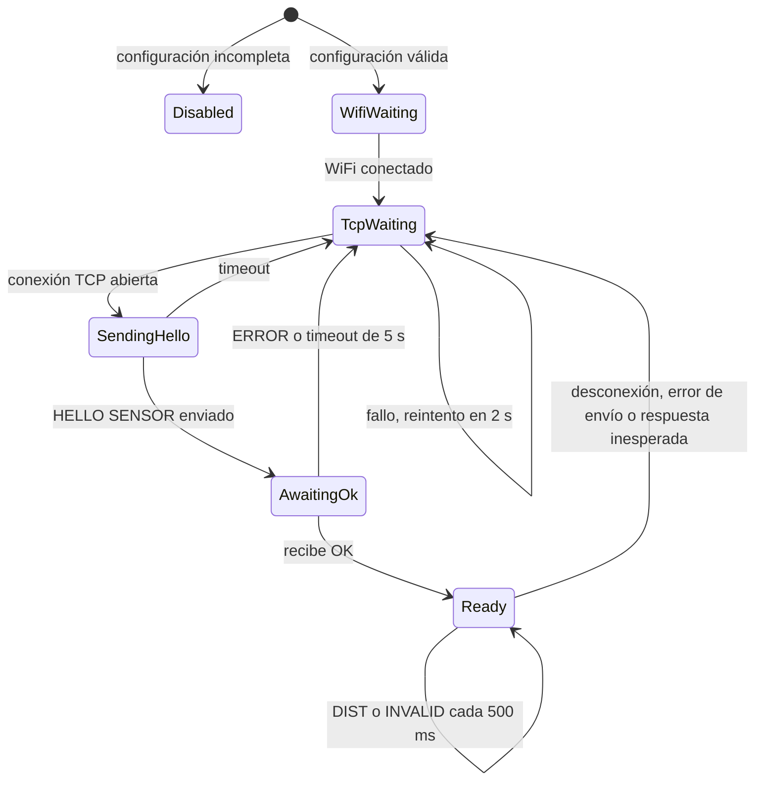

**ActuatorClient** (los LEDs quedan apagados en todo estado distinto de `CONNECTED`)

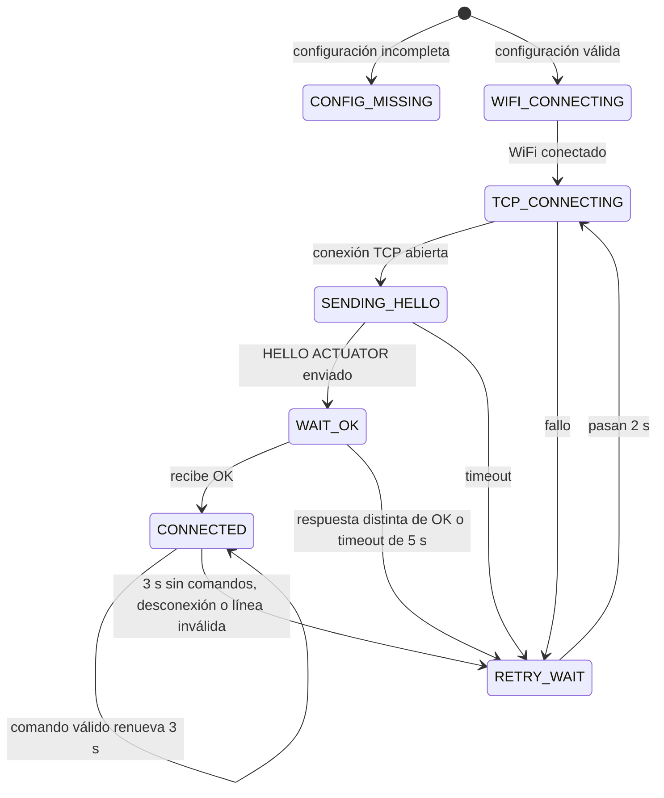

En ambos clientes, si se pierde el WiFi en **cualquier** estado, se cierra la conexión y se vuelve al estado de espera de WiFi (`WifiWaiting` o `WIFI_CONNECTING`), que reintenta cada 2 segundos. "Configuración incompleta" significa que en `secrets.h` falta el nombre de la red o la IP del servidor.

---

### Anexo C — Evidencias

**Montaje del sistema:** a la izquierda, el ESP32 actuador con los tres LEDs; al fondo, el ESP32 sensor con el HC-SR04.

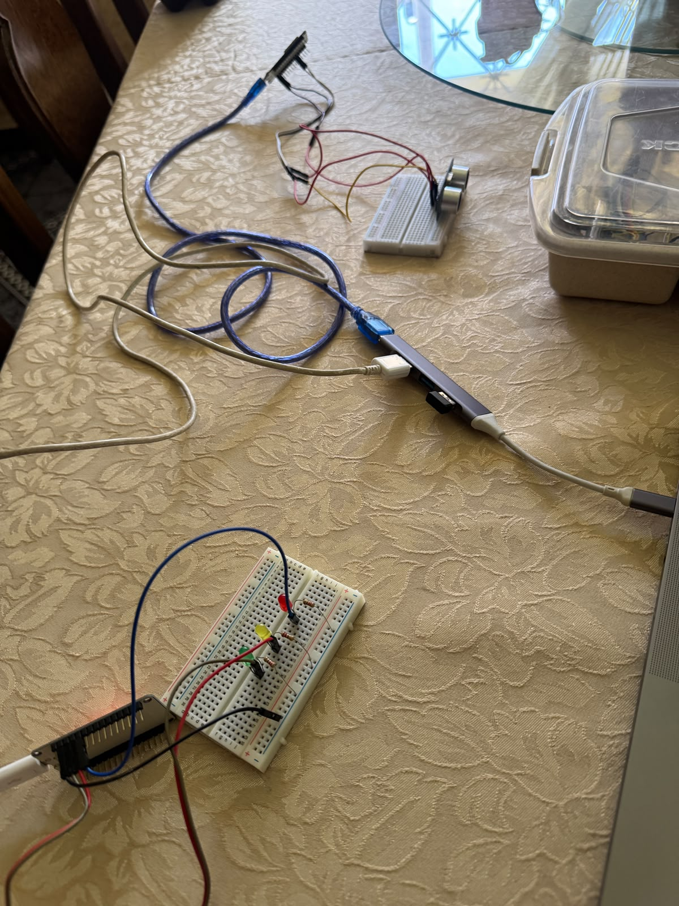

**Monitor serie del sensor:** cada medición se muestra en el monitor y se envía al servidor como `DIST`.

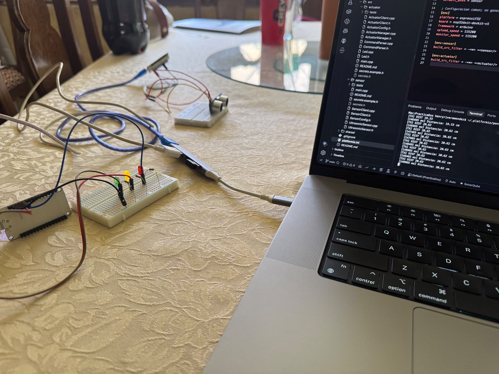

**Zona de peligro:** el sensor mide 5.93 cm y el actuador hace parpadear el LED rojo.

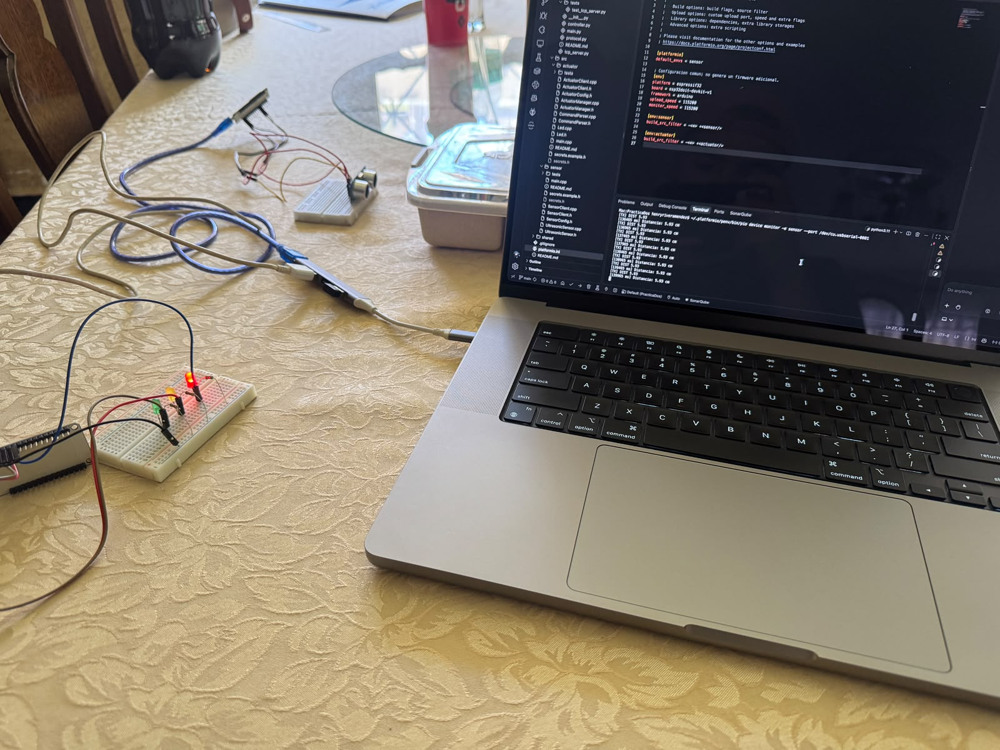

**Zona libre:** con el objeto lejos del sensor, el actuador enciende el LED verde.

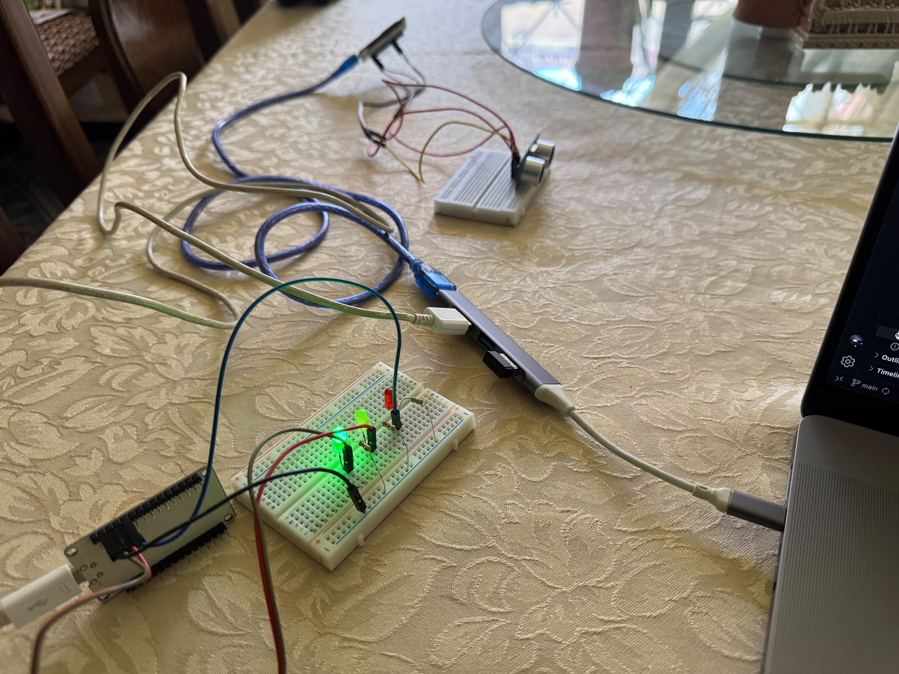

---
